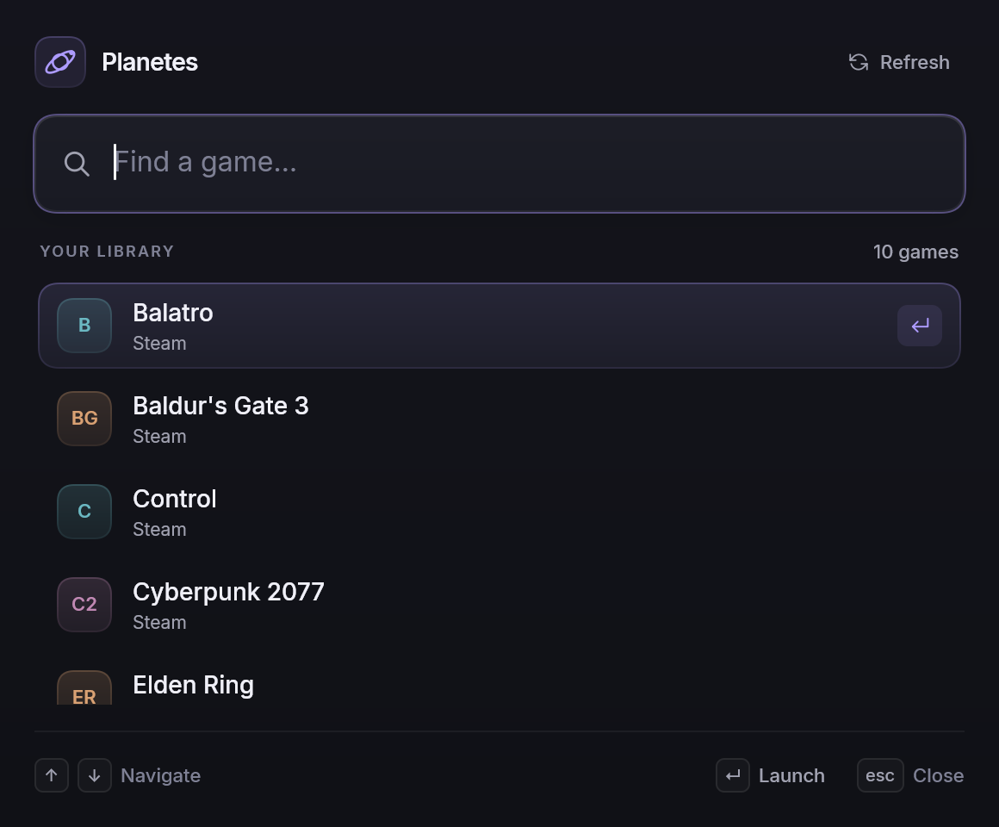

# Planetes

A minimal launcher for your installed games, built in Rust with [Rune](https://github.com/anomalyco/rune).
Open, search, select and launch through the game's store. Windows first, with portable shared logic.

## Windows download

Open [Releases](https://github.com/matteomejia/Planetes/releases), download the Windows x64 portable ZIP,
extract it and run `planetes.exe`. Rust is not required. The initial v0.1 build is unsigned and has no auto-updater.

Steam and Epic Games Launcher handle game startup. No account connection or API key is required in Planetes.



## Development

Windows requires Rust via rustup and the Visual Studio C++ Build Tools with a Windows SDK. The repository pins
Rust 1.99.1 and Rune revision `7256c7c2afb605862ccfe600a469df7330509efb`. Commit `Cargo.lock` with dependency changes.

```powershell
# Open the launcher. Search is focused automatically.
cargo run --locked

# Scan this desktop and print JSON (games + warnings).
cargo run --locked --quiet -p planetes-cli

# Restrict scanning or use a non-default location.
cargo run --locked --quiet -p planetes-cli -- --store steam --steam-root 'D:\Steam'
cargo run --locked --quiet -p planetes-cli -- --store epic --epic-manifests 'C:\ProgramData\Epic\EpicGamesLauncher\Data\Manifests'

# Deterministic UI preview (fixture data; no external game launch).
cargo run --locked -p planetes -- --scene library --snap artifacts/launcher.png

cargo fmt --all -- --check
cargo check --locked --workspace --all-targets
cargo test --locked --workspace
cargo clippy --locked --workspace --all-targets -- -D warnings
```

Type to search; Up/Down selects, Enter or a click launches, and Escape exits. Refresh (or Ctrl+R on Windows) rescans.
The app exits after the OS accepts a launch request and keeps errors visible on failure. This is a handoff to the
store client, not confirmation that the game started. No tray process, login, cover service or playtime tracker is used.

The charcoal/violet UI uses local Steam icon caches and Epic executable icons, with monogram fallbacks.
Icon reads and extraction run on Rune's image workers, retaining at most 128 64px icon rasters (about 2 MiB plus
mip levels). No artwork is downloaded. Selection and hover transitions respect the system's reduced-motion setting;
search results update immediately. Steam and Epic game startup have been validated on Windows.
Repeated application launches focus the existing window.

The scanner reads launcher metadata and checks install directories. It does not log in, contact store APIs, launch
games, or modify launcher files. Redirect stdout to save the JSON; keep machine-specific results in `artifacts/`
(gitignored). `--strict` returns exit code 2 when warnings occur while preserving the JSON report; otherwise partial
scans exit successfully. Invalid CLI arguments and output failures return nonzero.

The workspace separates `crates/core` (shared records), `crates/stores` (discovery), `crates/cli` (JSON output), and
`app` (Rune). `crates/launcher` constructs store URIs and performs OS handoff independently of the UI. Windows checks
protocol associations and uses ShellExecuteExW without a command shell; macOS uses `/usr/bin/open` (not yet tested).

### Detection boundaries

- Steam uses `steamlocate` to discover the client and every library, then reads each app manifest independently.
  Entries require the FullyInstalled state bit and an existing game directory. Music-only installs are skipped.
  Local `appinfo.vdf` type metadata excludes known software, tools, DLC and other non-games; games and demos remain.
  Missing type metadata preserves entries rather than hiding possible games, so non-games can appear when the
  cache is incomplete. Broken caches warn and fall back to manifest discovery. Apps whose FullyInstalled bit is
  cleared during a download/update are omitted for now.
- Epic reads `.item` manifests and excludes incomplete installs, non-game categories, and content-only entries.
  Install directories must exist. `LauncherInstalled.dat` was verified locally but is not needed as a second source.
- Malformed manifests, inaccessible libraries and missing install directories become warnings; other entries survive.
  A missing default Epic directory is normal. Failed Steam discovery and missing explicit paths produce warnings.
- Windows is verified. Steam discovery supports macOS through `steamlocate`, but macOS builds are not yet tested.
  Epic automatic discovery is currently Windows-only; an explicit native manifest directory works on other platforms.
- Fixtures use synthetic identities and temporary directories, with the structure of real manifests. Live scans and
  raw machine manifests stay outside tracked files.

## Docs

- [Direction](docs/direction.md): proposed architecture, MVP, open questions
- [Windows build check](docs/windows-build-check.md): verified toolchain, pinned Rune revision, results and commands
- [Releasing](docs/releasing.md): portable packages, GitHub release drafts, validation and measurement methodology
- Research
  - [Rune](docs/research/rune.md): the UI framework, what it offers and where it falls short for this app
  - [Landscape](docs/research/landscape.md): Playnite, GOG Galaxy, Heroic, Lutris and what to learn from them
  - [Store integrations](docs/research/store-integrations.md): how to detect, list and launch games per store
  - [Metadata](docs/research/metadata.md): IGDB, SteamGridDB, merging the same game across stores

## License

[MIT](LICENSE)
